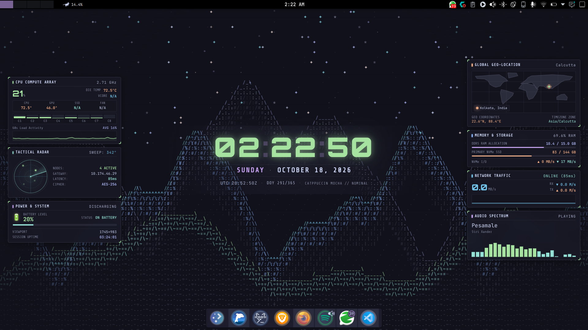
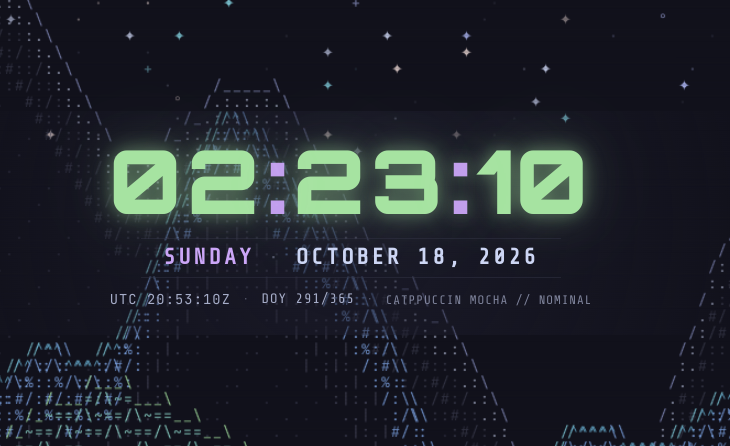
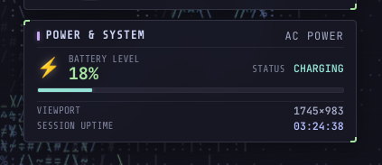

# CyberHUD

A sci-fi hacker-style live desktop wallpaper with a real-time HUD: a digital clock, live CPU/RAM/disk/network/battery telemetry, a tactical radar, and a world map showing your timezone. Rendered in the Catppuccin Mocha palette.

CyberHUD is a static web page served from a small local Node.js helper. The helper reads real system stats from the operating system and the page displays them. Nothing leaves your machine.

## Screenshots

<!-- Save screenshots into docs/screenshots/ and keep these paths. -->

**Full desktop**



**Clock and HUD detail**



**Battery on AC power**



## Features

- **Live clock:** large centered digital clock, weekday, date, UTC time, and day of year.
- **CPU compute array:** total load, eight per-core bars, frequency, die temperature, fan RPM, and a 60-second load sparkline.
- **Thermals:** CPU, GPU, and (where available) SSD temperatures.
- **Memory and storage:** RAM allocation, root disk usage, and disk read/write throughput.
- **Network traffic:** download and upload rates, a live traffic wave, latency, and default gateway.
- **Power and system:** battery level and state, viewport size, and system uptime.
- **Audio spectrum:** a 24-band frequency visualizer with the current track's title and artist. It shows bars only while something is playing.
- **Tactical radar:** an animated sweep. Contacts are decorative.
- **Global geo-location:** an equirectangular world map with a pulsing marker at your approximate location (derived from your timezone).
- **Animated backdrop:** an ASCII mountain range drawn on a canvas, with twinkling stars.

## How it works

```
 ┌────────────────────────── your laptop ──────────────────────────┐
 │                                                                 │
 │  OS (/proc, /sys, NetworkManager, UPower, ...)                   │
 │        │                                                        │
 │        ▼                                                        │
 │  stats-server.mjs  (Node.js + systeminformation)                 │
 │   • collects stats every 1 s                                    │
 │   • pings latency every 15 s                                    │
 │   • serves /stats (JSON) and dist/ (the built page)             │
 │        │  http://127.0.0.1:7777                                 │
 │        ▼                                                        │
 │  Browser / wallpaper host                                       │
 │   • src/main.ts polls /stats every 1.3 s                        │
 │   • draws the HUD and canvases                                  │
 │                                                                 │
 └─────────────────────────────────────────────────────────────────┘
```

Only the built page and the helper run locally. The helper binds to `127.0.0.1`, so it isn't reachable from other machines on your network.

## Data sources

| Display | Source | How it's collected |
|---|---|---|
| Clock, weekday, date, UTC, day of year | Browser | `Date` in the page, updated every animation frame |
| Timezone and map location | Browser | `Intl.DateTimeFormat().resolvedOptions().timeZone`, mapped to coordinates by a built-in lookup table (`TIMEZONE_COORDS` in `src/main.ts`). Unknown zones get an estimated longitude from the UTC offset. |
| Viewport size | Browser | `window.innerWidth` and `window.innerHeight` |
| Total and per-core CPU load | Helper | `si.currentLoad()` |
| CPU frequency | Helper | `si.cpuCurrentSpeed().avg` |
| CPU temperature | Helper | `si.cpuTemperature().main` (N/A if the sensor isn't exposed) |
| Fan RPM | Helper | `si.fans()` (N/A if unavailable) |
| GPU temperature | Helper | `si.graphics().controllers[0].temperatureGpu` |
| RAM used / total | Helper | `si.mem()`: `active` / `total` |
| Disk used / total | Helper | `si.fsSize()`, root filesystem (`/` on Linux, `C:` on Windows) |
| Disk read / write | Helper | `si.fsStats()` (bytes per second, converted to MB/s) |
| Network download / upload | Helper | `si.networkStats()`, summed over non-loopback interfaces |
| Latency | Helper | `si.inetLatency()` pings `8.8.8.8` every 15 seconds |
| Default gateway | Helper | `si.networkGatewayDefault()` |
| Battery level, charging, AC | Helper | `si.battery()`: `percent`, `isCharging`, `acConnected` |
| System uptime | Helper | `si.time().uptime` |
| Track title, artist, playback status | Helper | `playerctl metadata` (MPRIS), polled every 2 seconds |
| Audio spectrum (24 bands) | Helper | `parec` records the default audio output monitor (what you hear). An FFT with a Hann window splits it into log-spaced bands. The page receives updates about 20 times a second. The microphone is never used. |

The helper collects stats once per second and caches the result. The page polls `/stats` every 1.3 seconds. If the helper stops responding for three polls in a row, the network badge changes to `HELPER OFFLINE`.

The audio spectrum streams separately from `/music` using Server-Sent Events, so the bars update smoothly without changing the polling rate for other stats.

The page doesn't read hardware directly, since browsers can't access sensors. The helper does that work and exposes the results as JSON.

### Not available

Some values aren't exposed by typical operating systems or sensors. They show `N/A` instead of a made-up number:

- Voltage (VCORE)
- SSD temperature
- Radar contacts (decorative only)
- Cipher label (decorative only)

## Requirements

- **Node.js 18 or newer.** On CachyOS and other Arch-based systems: `sudo pacman -S nodejs npm`
- **Optional, for the audio spectrum and track info (Linux):** `sudo pacman -S playerctl libpulse`. `playerctl` reads track info from any MPRIS-compatible player. `libpulse` provides `parec`, which records the audio output. PipeWire systems (the CachyOS default) work with both.
- **npm**
- A desktop that can display a web page as wallpaper, or a browser in kiosk mode

## Installation

```bash
git clone https://github.com/rohith-vp/cyberhud.git cyberhud
cd cyberhud
npm install
npm run build
```

For development with live reload, run `npm run dev`.

`npm run build` writes the compiled site to `dist/`.

## Running

Start the helper, which also serves the built page:

```bash
node stats-server.mjs
# or
npm run stats
```

Then open:

- `http://127.0.0.1:7777`: the HUD
- `http://127.0.0.1:7777/stats`: the raw JSON the HUD consumes

### Run it at login (systemd, Linux)

```bash
mkdir -p ~/.config/systemd/user
cp cyberhud-stats.service ~/.config/systemd/user/
systemctl --user daemon-reload
systemctl --user enable --now cyberhud-stats.service
```

The service file assumes the project lives at `~/cyberhud` and that Node is at `/usr/bin/node`. Edit `cyberhud-stats.service` if your paths differ.

## Setting the wallpaper

Point your wallpaper host at `http://127.0.0.1:7777`. The helper must be running for live data to show.

Options depend on your desktop environment. For example, on Windows, Lively Wallpaper can display a web URL as a wallpaper. Linux and macOS need a third-party tool that supports web-page wallpapers.

## Configuration

- **Port:** change `PORT` in `stats-server.mjs`. Update the wallpaper URL to match.
- **Helper update rate:** change `setInterval(refresh, 1000)` in `stats-server.mjs`.
- **Latency target:** `si.inetLatency()` pings `8.8.8.8` by default. Pass a host to change it, for example `si.inetLatency('1.1.1.1')`.
- **Map location:** `TIMEZONE_COORDS` in `src/main.ts` maps IANA timezones to coordinates. Add or edit entries to place the marker more precisely.
- **Page refresh rate:** change `setInterval(poll, 1300)` in `src/main.ts`.

## Project structure

```
cyberhud/
├── index.html              Page layout, HUD cards, and element IDs
├── src/
│   ├── index.css           Catppuccin Mocha theme, layout, and effects
│   └── main.ts             Canvas animations, clock, and telemetry rendering
├── stats-server.mjs        Local helper: collects stats and serves the page
├── music.mjs               Audio capture, FFT, and media track info
├── cyberhud-stats.service  systemd user service for the helper
├── docs/screenshots/       Screenshots used in this README
├── tsconfig.json           TypeScript configuration
├── package.json
├── package-lock.json
└── dist/                   Build output (created by npm run build)
```

## Libraries and tools

Runtime:

- **[systeminformation](https://github.com/sebhildebrandt/systeminformation):** reads CPU, memory, disk, network, battery, sensor, and uptime data in the helper.
- **Node.js built-in modules:** `http`, `fs`, `path`, and `url` serve the page and JSON.
- **Google Fonts:** JetBrains Mono, Orbitron, and Share Tech Mono, loaded from `fonts.googleapis.com`.

Build and development:

- **[Vite](https://vitejs.dev/):** development server and production bundler.
- **[TypeScript](https://www.typescriptlang.org/):** the page code is written in TypeScript. Run `npm run typecheck` to check it.
- **HTML5 Canvas 2D API:** the mountain backdrop, radar, world map, and sparklines.

The page uses no UI framework, and the styles are hand-written CSS.

## Troubleshooting

- **The page shows `HELPER OFFLINE`:** the helper isn't running, or the port doesn't match. Check `http://127.0.0.1:7777/stats` in a browser.
- **`/stats` shows `warming up`:** the helper just started. Wait a second and refresh.
- **Temperatures show `N/A`:** on Linux, install `lm_sensors`, run `sudo sensors-detect`, and restart the helper. On Windows, temperature access often needs administrator rights or a tool such as LibreHardwareMonitor.
- **Battery shows `NO BATTERY` on a laptop:** the OS isn't exposing the battery to the helper. Check that the system has a battery under `/sys/class/power_supply` on Linux.
- **Spectrum stays flat while music plays:** check that `parec -d @DEFAULT_MONITOR@ --format=s16le --rate=44100 --channels=1 | head -c 1000 > /dev/null` runs without errors, and that `playerctl status` prints `Playing`.
- **Track info shows `NO MEDIA`:** no player is running, or the player doesn't support MPRIS. Start playback in a player such as Spotify or a browser tab, then run `playerctl -l` to list the players it can see.
- **Track info shows `NOT INSTALLED`:** install `playerctl` with `sudo pacman -S playerctl`.
- **Track info shows `ERROR`:** the message after it is the `playerctl` error. Run `playerctl metadata` in a terminal to see the same error.
- **Track info works in a terminal but not in the service:** the systemd user service may not have the session D-Bus address. Run `systemctl --user show-environment | grep DBUS` and check that `DBUS_SESSION_BUS_ADDRESS` is set. If it's missing, run `systemctl --user import-environment DBUS_SESSION_BUS_ADDRESS` and restart the service.
- **Latency shows `N/A`:** the machine can't reach the ping target. Change the target in `stats-server.mjs` if your network blocks it.

## Limitations

- Telemetry depends on what the operating system exposes. Some sensors need extra drivers or administrator rights.
- The radar and cipher label are decorative.
- The map location uses a timezone lookup table, not GPS, so the marker is approximate.
- Network totals include all active interfaces, including VPN and virtual adapters.
